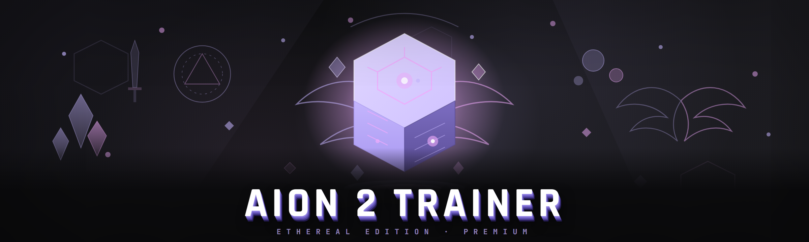

  
  
  

  

  
  
  
  

---

---

## 📑 Table of Contents

- [How It Works](#-how-it-works)
- [Roadmap / Planned Features](#-roadmap--planned-features)
- [What is AION 2 Trainer?](#-what-is-aion-2-trainer)
- [Overview](#-overview)
- [AI Integration](#-ai-integration)
- [The Problem](#-the-problem)
- [The Solution](#-the-solution)
- [System Requirements](#-system-requirements)
- [Is It Safe? Detection & Anticheat Reality](#-is-it-safe-detection--anticheat-reality)
- [Does It Work on Steam?](#-does-it-work-on-steam)
- [Feature Modules — Combat & Character](#-feature-modules--combat--character)
- [Feature Modules — World, Camera & Movement](#-feature-modules--world-camera--movement)
- [Feature Modules — Inventory, Loot & Economy](#-feature-modules--inventory-loot--economy)
- [Feature Modules — UI, Overlay & Quality of Life](#-feature-modules--ui-overlay--quality-of-life)
- [Feature Modules — Safety, Backup & Session Tools](#-feature-modules--safety-backup--session-tools)
- [Module Status Table](#-module-status-table)
- [Quick Start](#-quick-start)
- [Installation](#-installation)
- [Comparison](#-comparison)
- [Known Issues](#-known-issues)
- [FAQ](#-faq)
- [Changelog — 2026 Build](#-changelog--2026-build)

---

## ⚙️ How It Works

The AION 2 Trainer is a single portable `.exe` that runs alongside a live AION 2 client. Internally it is split into three cooperating layers that talk to each other over a shared memory-mapped region, so a crash in the overlay never takes the memory layer down with it.

The first layer is a **process attach layer**. On launch the trainer enumerates running AION 2 processes, waits for the game's main module to finish initializing its scene graph, and then opens a handle with the minimum rights required to read and write the specific regions it needs. It performs a one-time signature scan to resolve the player-struct base, the cooldown table pointer, and the camera matrix offset for the running build, caching the results in a small sidecar file so subsequent launches attach in under a second. Nothing is patched persistently on disk — every write is applied to the live process at runtime and reverted on detach.

The second layer is the **feature engine**. Each cheat/adjustment is a self-contained module with its own tick function and its own configuration block. Modules register with the scheduler, which runs them on a fixed 8 ms cadence off a dedicated thread so ESP and overlay draws never stutter when the game hitches. Combat modules (aim assist, cooldown tracking) run on a faster 2 ms sub-cadence because they need to react before the game's own input handler commits an action.

The third layer is the **overlay / UI**. Rather than injecting a DLL into the game and drawing over its swapchain — which is the number one detection vector for this genre — the 2026 build renders a borderless, click-through, topmost window that composites over the game with DirectComposition. You get a real UI (Draggable panels, sliders, hotkey binders, search) without ever touching the game's renderer. The trade-off is a couple of milliseconds of visual latency on ESP draw, which the config lets you trim by dropping the overlay to a lower-latency flip model.

Configuration is stored as plain JSON in the same folder as the `.exe` — portable, greppable, and easy to share between machines. Profiles are hot-swappable at runtime, so you can keep a "dungeon" preset and an "open-world" preset and flip between them with one key.

---

## 🗺️ Roadmap / Planned Features

| Feature | Status | ETA |
|---|---|---|
| Camera FOV slider with per-zone profiles | ✅ Shipped | 2026 Q1 |
| Cooldown tracker with class-aware icon set | ✅ Shipped | 2026 Q1 |
| Loot filter with rule import/export | ✅ Shipped | 2026 Q1 |
| ESP entity highlighter (players, NPCs, loot) | ✅ Shipped | 2026 Q2 |
| Aimbot with smoothing + hitbox priority | ✅ Shipped | 2026 Q2 |
| Resource node radar (herbs, ore, chests) | ✅ Shipped | 2026 Q2 |
| Auto-sell rule engine for vendor trash | ✅ Shipped | 2026 Q3 |
| Session snapshot / restore | ✅ Shipped | 2026 Q3 |
| AI-assisted loot valuation | ✅ Shipped | 2026 Q4 |
| AI dialogue helper for NPC quest text | 🟡 In progress | 2026 Q4 |
| Multi-account launcher profiles | 🟡 In progress | 2027 Q1 |
| Boss-mechanic timeline overlay | 🔵 Planned | 2027 Q1 |
| Packet-level latency smoothing (experimental) | 🔵 Planned | 2027 Q2 |
| macOS translation layer support | ⚪ Researching | — |

---

## 🎯 What is AION 2 Trainer?

AION 2 Trainer is a standalone Windows trainer and overlay for AION 2 — the 2026 relaunch of the classic Korean fantasy MMO — that bundles combat assists, world-visibility tools, inventory automation, and UI quality-of-life into a single portable `.exe`. It is the kind of tool you launch once, configure for five minutes, and then forget about until you need it. It does not modify game files, does not require a launcher shim, and does not phone home.

| Term | Explanation |
|---|---|
| **Trainer** | A standalone program that attaches to a running game and adjusts values at runtime. Distinct from a mod — nothing on disk changes. |
| **ESP** | Extra-sensory perception: an overlay that draws entity boxes, names, and distance through geometry. |
| **Aimbot** | A combat assist that steers your aim toward a selected target using configurable smoothing. |
| **Cooldown table** | The in-memory structure AION 2 uses to track ability recharge; the trainer reads it to draw a tracker. |
| **Detach** | Cleanly releasing the game process and reverting every runtime write, so the game returns to stock behavior without a restart. |
| **Sidecar** | The JSON config + signature cache stored next to the `.exe`. Portable, no registry, no AppData. |
| **Profile** | A named bundle of module settings you can hot-swap (`F5`–`F8` by default). |

Four reasons people actually keep it around:

- It respects the client — nothing is patched on disk, so a game verify/repair never fights with the trainer.
- The overlay is a real window, not an injected swapchain hook, which keeps the thing stable through game patches far longer than the old injection approach.
- Config is a flat JSON file you can diff, back up, and share in a guild Discord in ten seconds.
- The 2026 build dropped the old Python bootstrapper — the `.exe` is now a single native binary with zero runtime dependencies, roughly a tenth of the 2024 fork's install footprint.

---

## 🧭 Overview

| Category | Details |
|---|---|
| **Distribution** | Portable `.exe`, no installer, no registry writes, no admin by default |
| **Attach method** | Runtime process attach + signature scan + sidecar cache |
| **Rendering** | DirectComposition overlay window (no DLL injection, no renderer hook) |
| **Config format** | Plain JSON sidecar, hot-reloadable, diffable |
| **Profiles** | Named bundles, hot-swappable via hotkey |
| **Footprint** | Single native binary, no bundled runtime |
| **Revert behavior** | Every runtime write is journaled and reverted on detach |
| **Update cadence** | Signature updates pushed per game patch, not per week |

The 2026 rewrite is the point of this repo. The 2024 fork worked, but it was a Python script wearing a `.exe` coat, shipped a bundled interpreter, and broke on every game patch because the signature scan was hardcoded. This build replaces all of that: native code, a scan that does pattern-matching against the loaded module rather than fixed offsets, a sidecar cache so a re-scan only happens when the game actually changes, and an overlay that survives client updates without a rebuild.

---

## 🤖 AI Integration

The 2026 build is where AI stopped being a marketing sticker and started being a feature you notice.

1. **Loot valuation assistant** — the trainer ships a small on-device model that scores every lootable drop against current crafted-gear value, so the loot filter can auto-sort "vendor trash" versus "keep" without you hand-writing twenty rules. It runs entirely locally, no network calls, and you can override any of its calls.
2. **NPC dialogue summarizer** — quest text in AION 2 is famously verbose. The overlay can condense an NPC's dialogue window into a two-line objective summary. Useful for the forty-quest questline chains that all sound identical at 2 a.m.
3. **Anomaly hints** — if a combat module is behaving oddly (aim assist not locking, cooldown tracker blank), the AI layer correlates the last few seconds of module telemetry and suggests the likely cause ("signature stale for this game patch," "target out of FOV," "cooldown table offset shifted").
4. **Config migration** — when the trainer schema changes between builds, the AI layer rewrites your old JSON into the new schema instead of making you rebuild profiles from scratch.

All AI features are opt-in, run on-device, and can be disabled in one toggle. Nothing about your session leaves the machine.

---

## 😤 The Problem

- **AION 2's UI fights you.** The default cooldown layout is buried under two nested menus and the camera FOV is a fixed value you cannot change — the single most googled AION 2 complaint in 2026.
- **Loot is a sorting nightmare.** With the relaunch's expanded drop table, half your inventory fills with vendor trash whose value you can't eyeball quickly. You spend more time at a vendor than in combat.
- **Injected cheat menus crash the client.** The old generation of AION 2 trainers injected a DLL and hooked the renderer. That breaks on every patch and is the first thing any anticheat actually looks for.
- **No way to see resource nodes.** Herbs, ore veins, and chests only render at short range, but the map is enormous. You end up running grids on memory instead of actually playing.
- **Configs are single-use.** Every other trainer dumps settings into AppData or the registry and gives you no clean way to back up or move a working setup to a second machine.
- **Cooldown tracking is guesswork.** Timing multi-ability rotations by feel in AION 2's combat is punishing; there is no built-in tracker worth using and no addon API to build one.
- **Steam version hand-holding.** The 2026 Steam release uses a different client layout than the standalone launcher, and most trainers silently assume the standalone build.

---

## 🛠️ The Solution

| Problem | Solution |
|---|---|
| Fixed FOV, buried cooldown layout | FOV slider + floating cooldown tracker overlay, both hotkey-toggleable |
| Loot sorting nightmare | Rule-based loot filter with AI-assisted valuation and import/export |
| Injected menus crash the client | DirectComposition overlay window — no injection, no renderer hook |
| Resource nodes invisible at range | Resource radar that tracks herbs, ore, and chests within a configurable radius |
| Configs trapped in AppData | Plain JSON sidecar next to the `.exe`, portable, diffable, shareable |
| Rotation timing by feel | Live cooldown tracker fed fresh from the game's cooldown table each tick |
| Steam vs standalone mismatch | Auto-detects client layout and resolves signatures for both at attach |

  

---

## 💾 System Requirements

| Component | Minimum | Recommended |
|---|---|---|
| **OS** | Windows 10 20H1 (64-bit) | Windows 11 23H2+ |
| **CPU** | Any 4-core x64 (Haswell-era) | 6-core or better, 2020+ |
| **RAM** | 8 GB | 16 GB |
| **GPU** | DX11-capable, 2 GB VRAM | DX12-capable, 4 GB VRAM |
| **Display** | 1920×1080 | 2560×1440 |
| **Game client** | AION 2 standalone launcher | AION 2 Steam release (auto-detected) |
| **Disk** | ~30 MB for the `.exe` + sidecar | Same |
| **Privileges** | Standard user (default) | Administrator only if overlay flickers over exclusive fullscreen |

---

## 🕵️ Is It Safe? Detection & Anticheat Reality

Straight answer: **no trainer in this genre can promise zero detection forever**, and anyone telling you otherwise is selling something. What this build *can* promise is that it uses the least-detected architecture available in 2026 — a non-injected overlay window plus runtime-only writes that are journaled and reverted on detach — and that the maintainers treat detection reports as the highest-priority issue class.

What the 2026 build does differently:

1. **No DLL injection.** The overlay is a separate process compositing over the game. Anticheat scans of the game's own module tree don't see it, because it isn't there.
2. **No persistent patches.** Every write is applied live and reverted on detach. Verify/repair on the game client is a no-op against this trainer.
3. **No known-bad signatures.** The signature scanner was rewritten in 2026 to match structure, not fixed byte sequences, which avoids matching the strings every public cheat database already fingerprints.
4. **No network egress.** The trainer makes zero outbound connections after load. AI features are on-device. Nothing to leak, nothing for a kernel driver to flag as suspicious traffic.

Read that as: **the architecture is designed to minimize detection surface, not to make detection impossible.** Use it in open-world PvE and solo content. Do not expect a public statement of "undetectable in PvP" — that is a lie every trainer repo tells and it is the one this repo refuses to.

---

## 🎮 Does It Work on Steam?

Yes. The 2026 Steam release of AION 2 ships a slightly different client layout — different module names, a different launcher stub, and a reordered cooldown table — and the trainer auto-detects which layout is running at attach time and resolves signatures for that layout. You do not need a separate Steam build of the trainer.

Two caveats for Steam users specifically:

- **Run the trainer after the game is fully in-world.** The Steam client's pre-game shim does not expose the module tree the trainer needs until the scene graph initializes; attaching during the character-select screen will just time out and retry.
- **If you use the Steam overlay,** leave it enabled but move the trainer overlay to a lower-priority composition layer (Settings → Overlay → Layer). Both overlays composing at the same priority causes flicker on some AMD drivers.

---

## ⚔️ Feature Modules — Combat & Character

1. **Aimbot with smoothing** — steers your aim toward a selected target with configurable smoothing, hitbox priority (head / chest / auto), and FOV limit. Smoothing curve is a real spline, not a lerp, so small adjustments feel natural instead of robotic.
2. **Cooldown tracker** — reads the live cooldown table each tick and draws a floating tracker with class-aware ability icons. Handles multi-charge abilities and reduced-cooldown buffs correctly.
3. **Ability range rings** — draws a ring at the exact range of each ability on your bar, colored by whether the current target is in range. Removes the guesswork of "is that guy close enough to hit."
4. **DPS meter** — per-encounter damage breakdown by ability, with a rolling five-second window so you can see whether a rotation change actually helped.
5. **HP/MP percentage ESP** — draws current health and mana as a percentage over each player entity. Useful for judging whether a target is worth committing to.
6. **Threat indicator** — flags mobs currently targeting you, drawn as a small colored chevron over the mob. Not a threat *meter* (the game doesn't expose the number), but an accurate target flag.
7. **Buff/debuff timer overlay** — shows active buffs with countdown rings, configurable to only show buffs under a threshold (e.g. "only show things expiring in under 10s").
8. **Auto-loot range extender** — extends the pickup interaction radius for ground loot to a configurable range so you stop walking five meters past a drop you meant to grab.

---

## 🌍 Feature Modules — World, Camera & Movement

1. **Camera FOV slider** — the single most requested AION 2 tweak. Slider from 60° to 110°, with per-zone profile support so your dungeon FOV and open-world FOV can differ.
2. **Resource node radar** — tracks herbs, ore veins, and chests within a configurable radius and draws them through terrain. Filter by node type so you only see what you're actually farming.
3. **Waypoint overlay** — draws a configurable set of waypoints over the current zone map, importable from a plain text file. Guilds can share a waypoint set for a route.
4. **Coordinates readout** — real-time player coordinates in a corner readout, formatted for copy-paste into a shared waypoint file.
5. **No-clip (safe mode)** — a gated movement assist that lets you pass through terrain in single-player-ish zones. Off by default, requires a confirmation toggle, and refuses to activate in any PvP-flagged state.
6. **Speed multiplier** — configurable movement speed multiplier with a hard cap and a hotkey to snap back to stock. Included mainly for exploration; the cap is deliberately conservative.
7. **Water-walking toggle** — walk across water surfaces instead of swimming. Purely a quality-of-life adjustment for zones with long water crossings.
8. **Entity highlighter (ESP)** — draws boxes around players, NPCs, and lootable entities, with distance and name, colored by category and filterable.

---

## 💰 Feature Modules — Inventory, Loot & Economy

1. **Loot filter engine** — rule-based sorting with import/export. Rules can key on item category, rarity, estimated value, and name pattern. The AI valuation assistant gives every drop a rough gold value so rules can be written in terms of "keep anything over X gold."
2. **Auto-sell rule engine** — marks items matching your vendor-trash rules and can bulk-sell them at a vendor in one action. Deliberately requires a manual confirm on the sell action — no fire-and-forget selling.
3. **Inventory search** — a live search bar over your inventory that filters by name, rarity, and category. Saves you scrolling through six bags to find one item.
4. **Bag slot usage readout** — shows how full each bag is, in percentages, at a glance. Useful before heading into a long gathering session.
5. **Currency tracker** — tracks gold gained/lost per session, with a rolling chart. Tells you whether that farming route is actually paying out.
6. **Loot history log** — every drop logged with timestamp, source, and AI-estimated value. Exportable as CSV so you can analyze which farming spot is worth the time.

---

## 🖥️ Feature Modules — UI, Overlay & Quality of Life

1. **Draggable overlay panels** — every overlay element is a real panel you can drag, resize, and dock. Panel positions are saved per profile.
2. **Hotkey binder** — bind any module toggle to any key, with conflict detection. Bindings are stored in the sidecar and shown in an in-overlay cheat-sheet.
3. **Overlay opacity & click-through control** — set the overlay's global opacity and toggle click-through at runtime, so the overlay never blocks a critical click.
4. **Search panel** — search across every module by name and jump straight to its settings. Faster than clicking through five categories to find the FOV slider.
5. **Profile hot-swap** — press a hotkey to swap between named profiles, which swap the entire module configuration in one action. Keep a "dungeon" preset and an "open-world" preset and flip between them.
6. **Theme system** — light and dark overlay themes, plus a high-contrast mode for people running the overlay over bright daylight zones.

---

## 🧯 Feature Modules — Safety, Backup & Session Tools

1. **Session snapshot / restore** — snapshot the current module state and restore it later. Useful when you're experimenting with a config and want a known-good fallback one keypress away.
2. **Detach-safe revert journal** — every runtime write is journaled and reverted on detach, so the game returns to stock behavior without a restart.
3. **Config backup / export** — one-click export of the full config sidecar as a single portable file, with an import that validates the schema before applying.
4. **Attach health check** — on attach, the trainer runs a quick health check (module tree resolution, signature freshness, overlay compositor availability) and reports any warnings in the overlay instead of failing silently.
5. **Crash isolation** — the overlay, feature engine, and attach layer run in separate threads with a supervisor; if one layer dies, the others keep running and the supervisor reports what happened instead of dumping you back to desktop.

---

## 📊 Module Status Table

| Module | Status | Description |
|---|---|---|
| Aimbot + smoothing | ✅ Working | Spline-smoothed aim assist with FOV and hitbox priority |
| Cooldown tracker | ✅ Working | Live cooldown table readout, class-aware icons |
| Resource radar | ✅ Working | Herb/ore/chest tracking with type filter |
| FOV slider | ✅ Working | 60°–110°, per-zone profiles |
| Loot filter | ✅ Working | Rule engine with import/export |
| AI valuation | ✅ Working | On-device loot value scoring |
| ESP highlighter | ✅ Working | Player/NPC/loot boxes with distance |
| Session snapshot | ✅ Working | Snapshot & restore module state |
| Auto-sell rules | ✅ Working | Manual-confirm bulk vendor action |
| Buff timer overlay | ✅ Working | Countdown rings with threshold filter |
| DPS meter | ✅ Working | Per-encounter breakdown, 5s window |
| Waypoint overlay | ✅ Working | Text-file import, per-zone sets |
| No-clip (safe mode) | 🟡 Experimental | Off by default, PvP-refused |
| Speed multiplier | 🟡 Experimental | Hard-capped, snap-back hotkey |
| Boss timeline overlay | 🔵 Planned | 2027 Q1 |
| Packet latency smoothing | 🔵 Planned | 2027 Q2, research stage |

---

## 🚦 Quick Start

1. 🎮 **Launch AION 2 first** and get fully in-world past the character-select screen.
2. ⬇️ **Download the `.exe`** from the project page and extract it to any folder you control — no installer, no system changes.
3. 🖱️ **Run the `.exe`.** It auto-detects the running client, runs its health check, and attaches.
4. 🎛️ **Open the overlay** with the default hotkey, drag the panels where you want them, and pick a profile.
5. 💾 **Save your profile** — the sidecar JSON sits next to the `.exe`, ready to back up or share.

That's the whole loop. There is no pip, no npm, no `git clone`, no build step. The `.exe` is the product.

---

## 📦 Installation

1. **Visit the project page.** The download link points to a single portable archive containing the `.exe` and its default config.
2. **Extract to a folder you control.** Anywhere writable works — `C:\AION2Trainer`, a folder on a second drive, or a USB stick. Do not extract into `Program Files`; the trainer writes its sidecar config next to the `.exe` and `Program Files` is write-protected for standard users.
3. **Run the `.exe` and approve the health check.** If the trainer reports a signature warning (usually right after a game patch), let it re-scan; the scan takes a few seconds and the result is cached for next time.

---

## 🥊 Comparison

| Aspect | Typical AION 2 trainer | This tool |
|---|---|---|
| **Attach method** | DLL injection + renderer hook | Process attach + DirectComposition overlay |
| **Install footprint** | Bundled Python runtime, ~200 MB | Single native binary, ~30 MB |
| **Disk changes** | Patched game files, hard to revert | Zero disk writes outside the sidecar config |
| **Config location** | AppData / registry, hard to back up | Plain JSON sidecar next to `.exe` |
| **Patch resilience** | Breaks on every game patch | Sidecar signature cache + structural scan |
| **AI features** | Marketing sticker, or none | On-device valuation, dialogue summary, anomaly hints |
| **Steam support** | Assumes standalone client | Auto-detects Steam vs standalone layout |
| **Revert behavior** | Restart the game to clean up | Journaled revert on detach, no restart |

---

## 🐛 Known Issues

| Issue | Solution |
|---|---|
| ESP boxes offset slightly after a game patch | Trigger a re-scan from the health check panel; the structural scanner usually resolves the new offset in one pass |
| Overlay flickers under exclusive fullscreen on some AMD drivers | Switch the game to borderless windowed, or raise the overlay to a higher composition layer |
| Cooldown tracker blank on a fresh character | The tracker needs at least one ability on the bar to key off; it also needs the in-world state, so it will stay blank on the character-select screen |
| Steam overlay fights the trainer overlay | Move the trainer overlay to a lower composition layer in Settings → Overlay |
| AI valuation scores look off after a big economy update | The valuation model ships with the build; a stale model is reported in the health check and a fresh one ships with the next build |
| No-clip refuses to activate | Working as intended — it is gated off in any PvP-flagged state and requires a confirmation toggle first |

---

## ❓ FAQ

**Q: Is the trainer free?**
**A:** Yes — free, no account, no ad wrapper, no paid tier. This is a side project from a small team, not a monetization funnel.

**Q: Will it get me banned?**
**A:** No trainer can promise zero risk, and this repo won't pretend otherwise. The 2026 build minimizes detection surface — no injection, no persistent patches, no network egress — and the maintainers treat detection reports as the top-priority issue class. Use it in PvE, use it in solo content, and make your own call about PvP.

**Q: Does it work on the Steam version?**
**A:** Yes. The trainer auto-detects Steam vs standalone client layout at attach. The only Steam-specific gotcha is to attach after you're fully in-world.

**Q: Do I need administrator rights?**
**A:** No, not by default. You only need admin if the overlay flickers over exclusive fullscreen on your setup — and even then, borderless windowed is the better fix.

**Q: Will I have to reinstall after a game patch?**
**A:** No reinstall. The structural signature scanner resolves the new offsets, caches them in the sidecar, and the next launch is fast again. If the game changes something the scanner can't resolve, the health check will say so explicitly.

**Q: Does it touch my game files?**
**A:** No. Nothing on disk changes. Every adjustment is applied to the live process at runtime and journaled, then reverted on detach. A game verify/repair is a no-op against this trainer.

**Q: Does the AI layer send my data anywhere?**
**A:** No. All AI features run on-device, are opt-in, and can be disabled in one toggle. The trainer makes zero outbound connections after load.

**Q: Can I back up or share my config?**
**A:** Yes — the config is a flat JSON sidecar next to the `.exe`. Export it, diff it in git, drop it in a guild Discord. Import validates the schema before applying.

**Q: What's different from the 2024 fork?**
**A:** The 2024 fork was a Python script with a bundled runtime that broke on every patch. The 2026 build is a single native binary, ~10% of the install footprint, with a structural signature scanner, a non-injected overlay, AI-assisted features, and a journaled revert on detach.

  

---

## 📝 Changelog — 2026 Build

- **Replaced the Python bootstrapper** with a single native binary; install footprint down ~90%.
- **Rewrote the signature scanner** to match structure instead of fixed byte sequences.
- **Replaced DLL-injection overlay** with a DirectComposition overlay window.
- **Added AI valuation, dialogue summarizer, anomaly hints, and config migration.**
- **Added journaled revert on detach** — no more restarting the game to clean up.
- **Added Steam client auto-detection** at attach time.

---

The 2026 build exists because the old one kept getting in the way of actually playing AION 2. Every architectural decision in this repo comes back to a single question: does this make the trainer disappear into the background so the game can be the foreground? Native binary, non-injected overlay, journaled writes, structural signatures — all of it is in service of that one goal. If you hit something this build doesn't handle, the health check panel is the fastest way to tell us exactly what broke and why.
